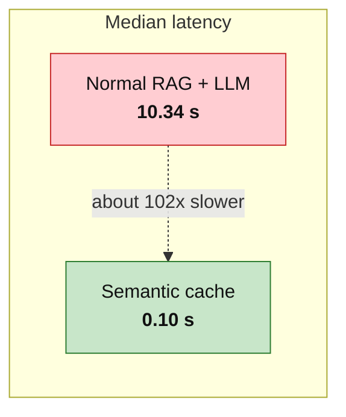
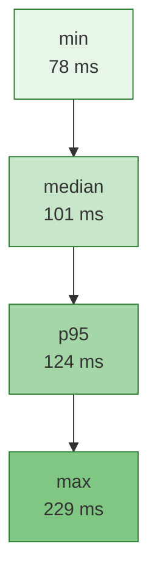
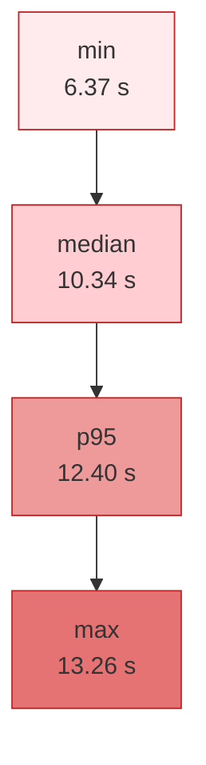
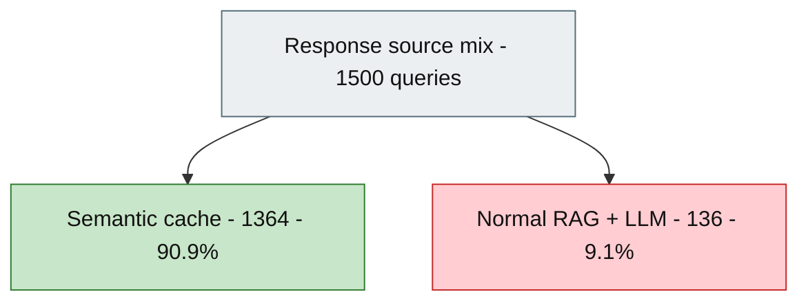
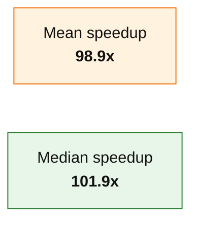
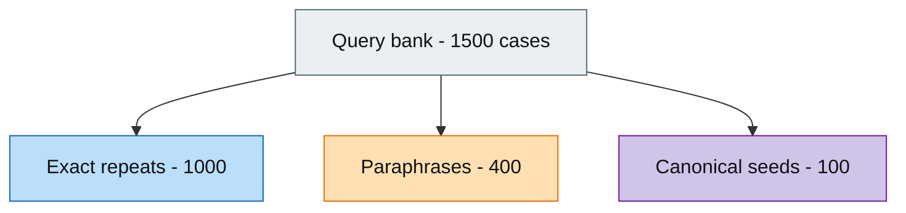
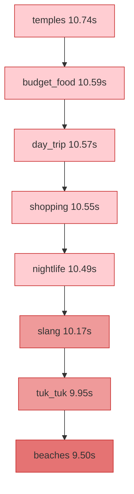

# Sri Lanka Explorer — Cache vs Normal RAG
### Performance results deck

**Run:** `2026-11-07T19:42:58Z` · **Model:** `llama3.1:8b` · **Queries:** 1,500 · **Errors:** 0  
**Wall clock:** ~25.3 minutes · **Artifact:** `tests/results/latest_summary.json`

---

## 1. Headline

| Metric | Normal method (RAG + Ollama) | Our solution (semantic cache) | Gap |
|---|---:|---:|---:|
| Responses | 136 | 1,364 | — |
| Median latency | **10.34 s** | **0.10 s** | **~102× faster** |
| Mean latency | 10.12 s | 0.10 s | **~99× faster** |
| p95 latency | 12.40 s | 0.12 s | **~100× faster** |

> Same API (`POST /query`), same short answers, same machine.  
> **Normal path** = embed → Postgres retrieval → Ollama.  
> **Solution path** = embed → Redis geo + intent-guarded semantic hit.

---

## 2. Latency comparison

### Cache path percentiles (milliseconds)

### Normal RAG path percentiles (seconds)

---

## 3. Where answers came from

| Source | Count | Share |
|---|---:|---:|
| `cache` | 1,364 | 90.9% |
| `llama3_rag_fallback` | 136 | 9.1% |

Expect-match rate (predicted path vs actual): **95.6%** (1,434 / 1,500).

---

## 4. Speedup

| Speedup | Value |
|---|---:|
| Mean | **98.9×** |
| Median | **101.9×** |

For the friend demo slide: *“Repeated / near-repeat travel questions answer in ~0.1s instead of ~10s.”*

---

## 5. Query bank composition

Saved fixture: `tests/fixtures/query_bank.json` (1,500 cases · 100 families).

| Role | Count | Purpose |
|---|---:|---|
| Canonical | 100 | First ask per family → populate cache (baseline) |
| Paraphrase | 400 | Intent variants (may hit or miss strict re-rank) |
| Exact repeat | 1,000 | Guaranteed cache-path load for latency stats |

---

## 6. Seed RAG latency by intent (sample)

Mean seconds for family-seed RAG calls (short answers):

| Intent | Mean seed RAG (s) |
|---|---:|
| temples | 10.74 |
| budget_food | 10.59 |
| day_trip | 10.57 |
| shopping | 10.55 |
| nightlife | 10.49 |
| slang | 10.17 |
| tuk_tuk | 9.95 |
| beaches | 9.50 |

Baseline cost is consistently ~10s across tourism intents — the win is avoiding that path on repeats.

---

## 7. Method (reproducible)

1. Generate bank: `python tests/generate_query_bank.py --count 1500`
2. Flush Redis + restart API (clean cache)
3. Warm Ollama once (discarded)
4. Run: `python tests/benchmark_cache_vs_rag.py --warmup`
5. Summarize: `tests/results/latest_summary.json` + `latest.csv`

FastAPI tags each response with `source` (`cache` | `llama3_rag_fallback`). Client/runner records wall latency per call.

---

## 8. Takeaways for the presentation

1. **Normal method** (retrieve + generate) is ~**10 s** median on this host with `llama3.1:8b` short answers.
2. **Semantic cache** returns in ~**100 ms** median for repeat / high-similarity follow-ups.
3. Measured speedup ≈ **100×** (median), with **0 errors** over **1,500** queries.
4. Architecture still protects geography/intent (strict re-rank) — not every paraphrase hits; failed matches fall back to RAG (included in the 136 baseline calls).

---

## 9. Files

| File | Description |
|---|---|
| `tests/fixtures/query_bank.json` | Fixed 1,500 test queries |
| `tests/benchmark_cache_vs_rag.py` | Runner |
| `tests/results/latest.csv` | Per-query timings |
| `tests/results/latest_summary.json` | Aggregates used in this deck |
| `tests/results.md` | This presentation |
